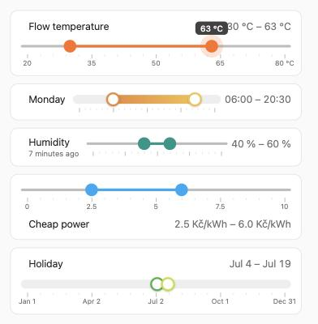

# Range Slider Card

A Home Assistant dashboard card with **one slider and two handles**. It sets two entities at
once — a start and an end — and looks like the standard Home Assistant slider.

Use it for anything that is a range made of two values:

- a heating or hot water window: `06:00 – 20:30`
- minimum and maximum temperature, humidity or fan speed
- a "from / to" pair of `input_number` helpers
- a holiday or a season: `4 Jul – 19 Jul`



## Supported entities

Both entities must be of the same kind:

| Kind | Domains |
|---|---|
| Numbers | `input_number`, `number` |
| Times | `time`, `input_datetime` (time only, no date) |
| Dates | `date`, `input_datetime` (date only, no time) |

For numbers, the minimum, maximum and step come from the start entity, unless you set them in
the card. For times, the slider runs from 00:00 to 24:00 in 15-minute steps by default. For
dates, it runs from 1 January to 31 December of the current year in 1-day steps.

## What the values are

`format` sets how values are shown. Pick one in the visual editor or in YAML:

| `format` | Shown as | Unit |
|---|---|---|
| `number` | `12.5 m³` | the entity's unit, or your own `unit` |
| `time` | `06:30` | number entities hold minutes from midnight (0–1440) |
| `duration` | `1 h 45 min` | number entities hold minutes |
| `date` | `4 Jul` | date entities only |
| `temperature` | `21.5 °C` | `°C` |
| `percentage` | `40 %` | `%` |
| `distance` | `12 km` | `km` |
| `length` | `2.4 m` | `m` |
| `speed` | `50 km/h` | `km/h` |
| `power` | `1,500 W` | `W` |
| `energy` | `3.2 kWh` | `kWh` |
| `volume` | `120 L` | `L` |
| `weight` | `80 kg` | `kg` |
| `pressure` | `1.5 bar` | `bar` |
| `currency` | `2.50 CZK` | the currency set in Home Assistant |

The entity's own unit wins over the default unit of a format. Set `unit` to write any unit you
like, for example `unit: Kč/kWh` or `unit: rpm`. Numbers and dates use the language of your
Home Assistant profile.

## Installation

### HACS

1. HACS → ⋮ → **Custom repositories** → add `https://github.com/baghamut/range-slider-card`,
   type **Dashboard**.
2. Install **Range Slider Card** and reload the browser.

### Manual

1. Copy `range-slider-card.js` to `config/www/`.
2. Settings → Dashboards → ⋮ → **Resources** → add `/local/range-slider-card.js`, type
   **JavaScript module**.

## Configuration

Add the card from the card picker (**Range Slider Card**) and pick the two entities in the
visual editor. Like the editor of Home Assistant's tile card, the rest folds into sections:
**Content** (name, secondary information, icon, value kind and unit, where the values go, full width, small text), **Slider** (style, colours,
range, step, gap, push, scale and ticks) and **Interactions** (tap, hold, double tap). Or use YAML:

```yaml
type: custom:range-slider-card
start_entity: input_datetime.heating_start
end_entity: input_datetime.heating_end
name: Heating
```

| Option | Default | Description |
|---|---|---|
| `start_entity` | required | Entity for the left handle |
| `end_entity` | required | Entity for the right handle |
| `name` | start entity's name | Title shown above the slider |
| `icon` | start entity's icon | Icon next to the title |
| `style` | `standard` | `standard` — thin track like the Home Assistant slider; `gradient` — thick track with a colour gradient and white handles |
| `color` | `primary` | A Home Assistant colour name (`red`, `teal`, …) or any CSS colour (`#e98a3c`) |
| `color_end` | `color` | With `style: gradient`: the colour at the right handle |
| `format` | by entity | How values are shown, see the table above |
| `unit` | by format | Your own unit text for number formats |
| `min` / `max` | from the entity | Range of the slider (times: minutes, `0` – `1440`; dates: `YYYY-MM-DD`) |
| `step` | from the entity | Step (times: minutes, default `15`; dates: days, default `1`) |
| `min_gap` | `step` | Smallest distance between the two handles. Never less than one step; rounded to whole steps |
| `secondary_info` | none | A second line under the name, from the start entity: `state`, `last_changed`, `last_updated` or any attribute; a list shows several, joined by `·` |
| `position` | `header` | Where the values are: `header` (next to the name, the slider on its own line below), `inline` (icon, name, slider and values on one line, like Home Assistant's number slider) or `below` (one line, with the start value under the left end of the slider and the end value under the right end) |
| `full_width` | `false` | On one line (`inline`, `below`) the slider keeps the size of a number slider; `true` lets it take the rest of the line, and values next to it move below it |
| `show` | `both` | Which values to show: `both`, `low`, `high` or `none` |
| `small` | `false` | Show the values in small text |
| `push` | `false` | `true` lets a handle push the other one along instead of stopping at it; both entities change |
| `show_scale` | `true` | Show the labels under the slider |
| `show_ticks` | `true` | Show the ruler ticks (every hour for a whole day, otherwise every step or 20 parts) |
| `show_icon` | `true` | Show the icon |
| `tap_action`, `hold_action`, `double_tap_action` | more info | What a tap, a long press or a double tap on the icon or name does. Any Home Assistant [action](https://www.home-assistant.io/dashboards/actions/); by default a tap or long press opens the start entity's details |

### Examples

Minimum and maximum temperature from two `input_number` helpers:

```yaml
type: custom:range-slider-card
start_entity: input_number.boiler_min_flow
end_entity: input_number.boiler_max_flow
name: Flow temperature
color: deep-orange
min_gap: 5
```

A time window with 30-minute steps:

```yaml
type: custom:range-slider-card
start_entity: time.dhw_window_start
end_entity: time.dhw_window_end
name: Hot water
step: 30
```

A gradient slider over two `number` entities that hold minutes:

```yaml
type: custom:range-slider-card
start_entity: number.heating_monday_start
end_entity: number.heating_monday_end
name: Monday
format: time
step: 30
style: gradient
color: "#e98a3c"
color_end: "#f4c04e"
```

A holiday from / to, two date helpers:

```yaml
type: custom:range-slider-card
start_entity: input_datetime.holiday_from
end_entity: date.holiday_to
name: Holiday
style: gradient
color: green
color_end: lime
```

A price band with your own unit:

```yaml
type: custom:range-slider-card
start_entity: input_number.cheap_power_low
end_entity: input_number.cheap_power_high
name: Cheap power
unit: Kč/kWh
```

## How it behaves

- Drag a handle, or tap the track to move the nearest handle there.
- While a handle moves, a bubble above it shows the exact value.
- The value is written when you release the handle, so each drag is one service call per entity.
- The handles cannot cross: they always stay at least `min_gap` apart.
- Keyboard: Tab to a handle, then the arrow keys (one step) or Page Up / Page Down (ten steps).
- A time of 24:00 is saved as 23:59, because Home Assistant times cannot be 24:00.

## License

MIT
